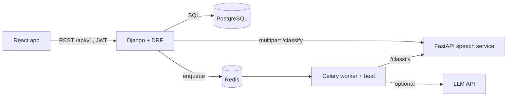
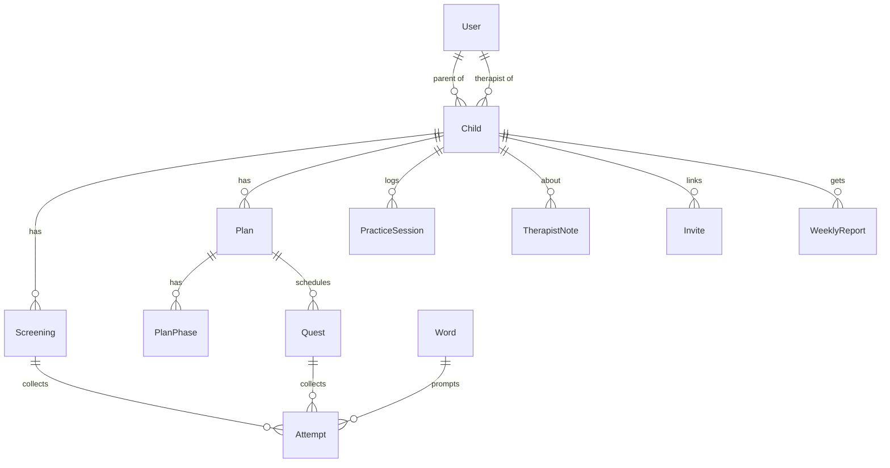

# Architecture

## Surfaces

| Surface             | Route prefix          | Who              | Notes                                                    |
| ------------------- | --------------------- | ---------------- | -------------------------------------------------------- |
| Public website      | `/`, `/how-it-works`… | Anyone           | Includes the anonymous 3-word free check                 |
| Auth + onboarding   | `/login`, `/signup`, `/onboarding/child` | Guests, new parents | Child profile + consent                   |
| Child app           | `/play/:childId/*`    | Child (on a parent's device) | Full-screen, voice-led, no scores, parental exit gate |
| Parent app          | `/parent/*`           | Parent / adult learner | Today, plan approval, reports, progress, privacy   |
| Therapist dashboard | `/clinic/*`           | Therapist        | Caseload, recording review, plan editor, notes, invites  |

All four are one React app (`frontend/`), code-split per route.

## Services

- **Django** owns all data and business rules. Views are thin; logic sits in each app's `services.py`.
- **AI service** is stateless: audio in, label + confidence out. It never stores audio and is never called by
  the browser. If it's down, `apps/common/ai_client.py` falls back to a heuristic so practice never blocks.
- **Celery** runs slow or scheduled work: weekly parent reports (Thursday 18:00 Cairo) and re-classifying
  stored recordings when a new model ships.

## Core flows

**Screening.** `POST /screenings/` → for each of 11 words, `POST /screenings/:id/attempts/` (audio) → Django saves
the file, calls `/classify`, and asks the child to repeat if confidence < 0.55 → `POST /screenings/:id/complete/`
scores per sound and position, sets severity bands (≥85 typical, 50–84 moderate, <50 severe) and generates a
`pending_approval` plan.

**Plan approval.** Parent approves with a practice time (`POST /plans/:id/approve/`). If a therapist is linked the
plan waits for them (`approved`); otherwise it goes `active` and a week of quests is created.

**Daily quest.** Warm-up → sound alone → words. Each try is an `Attempt`. `POST /quests/:id/complete/` writes a
`PracticeSession`, gives stars for trying (always 3), updates the streak, and applies the ladder rule:
up after 2 sessions ≥ 80%, down after 3 sessions < 50%. Only therapists can skip levels.

**Human in the loop.** Every stored recording enters the therapist's review queue (least confident first). A
therapist label overrides the AI label everywhere (`Attempt.final_label`) and becomes training data.

## Data model (backend)

## Privacy and safety

- Recording requires explicit parent consent (`consentRecording`); research use is a separate opt-in.
- Recordings are only visible to the parent and linked therapist, and parents can delete them all at once.
- The free check analyses audio in memory and stores nothing.
- Every result screen carries the "screening, not diagnosis" disclaimer; lateral lisps or < 50% accuracy show a
  "see a therapist in person" recommendation.

## Environments

| Setting module           | Used by                     |
| ------------------------ | --------------------------- |
| `config.settings.dev`    | Local + docker-compose      |
| `config.settings.test`   | pytest + CI (SQLite, eager Celery, no AI calls) |
| `config.settings.prod`   | Deployment (secure cookies, HSTS, required secret) |
